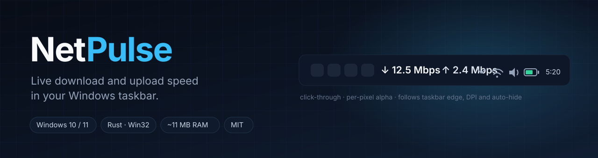
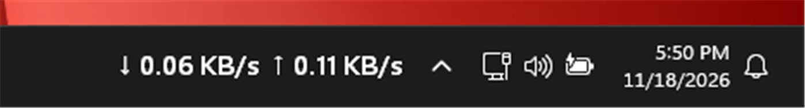
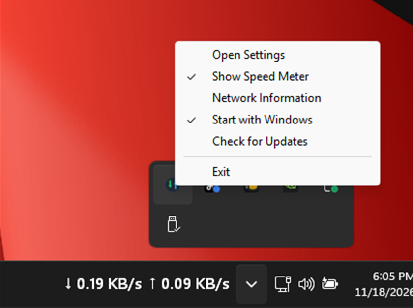
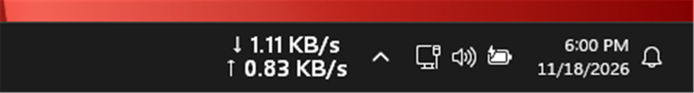
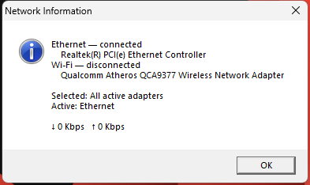
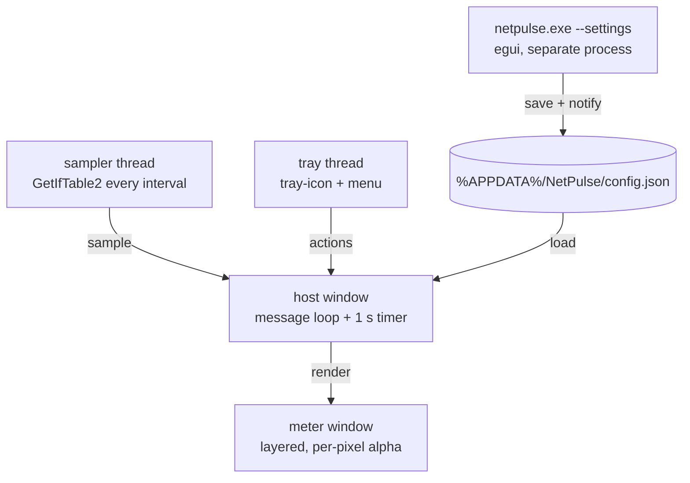

<p align="center">
  
</p>

<p align="center">
  <b>Live download and upload speed in your Windows 10 / 11 taskbar.</b><br>
  Native Win32 and Rust — no Electron, no background service, no traffic of its own.
</p>

<p align="center">
  <a href="https://github.com/Kaziopu5938/netpulse"></a>
  
  
  
  <a href="https://github.com/Kaziopu5938/netpulse/releases/latest"></a>
  <a href="LICENSE"></a>
</p>

<p align="center">
  
</p>

NetPulse reads the counters Windows already keeps for every network interface (`GetIfTable2`), turns
the difference between two readings into bytes per second, and draws the result in the taskbar band
next to the system tray. One second by default, no speed tests, no traffic, no GPU context in the
background process.

---

## Features

| | |
| --- | --- |
| **Live readout** | `↓ 3.84 MB/s ↑ 645 KB/s` — refresh every 250 ms to 5 s, 1 s by default |
| **Two layouts** | One line by default, or download and upload stacked on two lines |
| **Ethernet & Wi-Fi** | PPP and mobile broadband too; only physical interfaces are counted |
| **Adapter selection** | Automatic active-adapter detection, or pin one interface in Settings |
| **Honest idle/disconnect** | `0` when idle, `No network` when the link drops, counters that reset never go negative |
| **Compact & themeable** | Bytes by default (KB/s, MB/s) or bits (Kbps, Mbps); 16 px Segoe UI Semibold by default; colour, rounded background with real per-pixel opacity, tray side and gap |
| **Starts with Windows** | On by default; toggle it in Settings or from the tray |
| **Tray icon** | Tooltip with live speeds, Open Settings, Show/Hide, Network Information, Start with Windows, Check for Updates, Exit |
| **Settings window** | egui/eframe with a live taskbar preview, light/dark/system theme, everything applied live and saved as JSON |
| **Multi-DPI & auto-hide aware** | Follows taskbar edge, thickness, DPI and auto-hide on a 1 s tick; rotated text on vertical taskbars |
| **Small** | ~11 MB working set, one 1 Hz sampler thread, 4.9 MiB self-contained executable |

## Taskbar integration — the honest version

This was the deciding design question, and it deserves a straight answer:

- **Windows 10** taskbars used to accept third-party *Desk Bands* / toolbars through COM shell
  extensions. They are deprecated, require code injected into `explorer.exe`, and break easily.
- **Windows 11 removed that surface completely.** There is no supported API that lets a third-party
  process add a text widget to the taskbar or put one *inside* the notification area.
- The only genuinely supported taskbar API is `Shell_NotifyIcon` — the tray icon. NetPulse uses it
  (via `tray-icon`) and shows live speeds in its tooltip. A tray icon cannot render arbitrary text
  next to itself.

NetPulse therefore implements two clearly separated display modes:

| Mode | What it actually is | Supported | Default |
| --- | --- | --- | --- |
| **Overlay** | A borderless, click-through (`WS_EX_TRANSPARENT`), no-activate, topmost layered window placed in the taskbar band beside `TrayNotifyWnd`. Text is drawn as an antialiased GDI mask, composited into a 32-bit premultiplied DIB and pushed with `UpdateLayeredWindow`, so it sits on any taskbar colour without fringing. It never takes clicks from taskbar buttons. | Yes | Yes |
| **Taskbar dock** | The same window converted to a `WS_CHILD` of Explorer's `Shell_TrayWnd` (`SetParent`), so Windows itself clips and moves it with the taskbar. Recreated after Explorer restarts (`TaskbarCreated`). | **Unsupported by Microsoft**; may break after Windows updates. | No |

Neither mode injects code into Explorer, and neither pretends to be a system taskbar control.

## Screenshots

<table>
  <tr>
    <td width="50%"><br><sub><b>Settings</b> — rail navigation and a live taskbar preview</sub></td>
    <td width="50%"><br><sub><b>Tray menu</b> — operations without opening Settings</sub></td>
  </tr>
  <tr>
    <td width="50%"><br><sub><b>One line</b> (default) — sits directly beside the hidden-icons chevron</sub></td>
    <td width="50%"><br><sub><b>Two lines</b> — download above upload, centred in the taskbar</sub></td>
  </tr>
  <tr>
    <td colspan="2" align="center"><br><sub><b>Network Information</b> — current adapter, sample speed and detected interfaces</sub></td>
  </tr>
</table>

## Install

### Option 1 — Download the installer (recommended)

No toolchain, no build step. Grab the latest build from
[**Releases**](https://github.com/Kaziopu5938/netpulse/releases/latest):

1. **Download `NetPulse-1.1.1.msi`** and double-click it.
   - Installs per user into `%LOCALAPPDATA%\Programs\NetPulse` — **no admin prompt**.
   - Adds a Start Menu shortcut (`NetPulse Settings`) and registers the autostart entry.
   - Starts immediately after install; uninstall from *Windows Settings → Apps*.
2. **Prefer no installer at all?** Download `NetPulse-1.1.1.exe` — a portable, single-file build.
   Run it from anywhere (pin it, put it on a USB stick); *Settings → System* can add it to startup.

Verify your download against the SHA-256 checksums attached to the release (`SHA256SUMS.txt`).
The binaries carry no code-signing certificate yet, so SmartScreen may ask once before the first
run — choose *More info → Run anyway*.

<details>
<summary><b>Option 2 — Build from source</b> (only if you want to hack on it)</summary>

Requirements: Windows 10/11 x64, [Rust stable](https://rustup.rs) and either the MSVC toolchain
(Visual Studio Build Tools) or a MinGW-w64 toolchain for the `x86_64-pc-windows-gnu` target.

```powershell
git clone https://github.com/Kaziopu5938/netpulse.git
cd netpulse
cargo build --release
.\target\release\netpulse.exe
```

`target\release\netpulse.exe` is standalone (no runtime DLLs with the MSVC or self-contained GNU
linker). Copy it anywhere and run it.

Building the MSI yourself: `installer/NetPulse.wxs` is a WiX 3 definition, built by
`installer/build-installer.ps1`:

```powershell
# one-time: download wix314-binaries.zip from https://github.com/wixtoolset/wix3/releases
powershell -ExecutionPolicy Bypass -File installer\build-installer.ps1 -WixBin C:\path\to\wix\bin
# installer\NetPulse-1.1.1.msi
```

</details>

### Autostart

NetPulse starts with Windows by default. *Settings → System* and the tray menu toggle it; the
preference is stored in the config file and mirrored to one registry value at launch:

```
HKCU\Software\Microsoft\Windows\CurrentVersion\Run\NetPulse = "C:\path\to\netpulse.exe"
```

No scheduled task, no service, no admin rights.

## Usage

The tray menu:

- **Open Settings** — launches `netpulse.exe --settings` (a second, short-lived process).
- **Show Speed Meter** — toggle the taskbar meter without touching the config file.
- **Network Information** — active adapter, current sample and the detected physical interfaces.
- **Start with Windows** — toggles the Run entry; the checkmark follows the saved preference.
- **Check for Updates** — reports the running version (no update feed is configured in this build).
- **Exit** — stops the process and removes the tray icon.

Command line:

| Flag | Effect |
| --- | --- |
| *(none)* | Start the tray icon and the taskbar meter (single instance). |
| `--settings` | Open the settings window; focuses an existing one instead of duplicating it. |
| `--enable-startup` | Add the HKCU Run entry for this executable. |
| `--disable-startup` | Remove it. |

## Configuration

`%APPDATA%\NetPulse\config.json` is created on the first change. The background app reloads it
immediately when Settings saves, so edits take effect without restarting.

```json
{
  "visible": true,
  "show_download": true,
  "show_upload": true,
  "unit": "bytes",
  "layout": "horizontal",
  "font_family": "Segoe UI Semibold",
  "font_size": 16,
  "text_color": "#FFFFFF",
  "background": "transparent",
  "background_color": "#1F1F1F",
  "background_opacity": 210,
  "position": "left_of_tray",
  "offset": 2,
  "update_interval_ms": 1000,
  "adapter": null,
  "dock_mode": "overlay",
  "theme": "system",
  "start_with_windows": true
}
```

| Field | Values | Meaning |
| --- | --- | --- |
| `visible` | `true` / `false` | Show the meter (tray toggle writes this). |
| `show_download`, `show_upload` | `true` / `false` | Which halves to draw. Both off hides the meter. |
| `unit` | `bytes` / `bits` | KB/s, MB/s (default) or Kbps, Mbps, scaled automatically. |
| `layout` | `horizontal` / `vertical` | One line, or download above upload on two lines. |
| `font_family`, `font_size` | face name, 8–24 px | Taskbar text; defaults to Segoe UI Semibold at 16 px. |
| `text_color` | `#RRGGBB` | Text colour; first run follows the light/dark taskbar theme. |
| `background` | `transparent` / `solid` | Rounded pill behind the text or fully transparent. |
| `background_color`, `background_opacity` | `#RRGGBB`, 0–255 | Pill colour and real alpha. |
| `position`, `offset` | `left_of_tray` / `right_of_tray`, px | Where to sit relative to `TrayNotifyWnd`. |
| `update_interval_ms` | 250–5000 | Sampling interval. |
| `adapter` | GUID string or `null` | Pin one interface; `null` sums all active physical ones. |
| `dock_mode` | `overlay` / `taskbar` | See [Taskbar integration](#taskbar-integration--the-honest-version). |
| `theme` | `system` / `light` / `dark` | Settings window theme (the meter has its own colours). |
| `start_with_windows` | `true` / `false` | Mirrored to the HKCU Run entry when NetPulse starts. |

## Architecture



| Path | Responsibility |
| --- | --- |
| `src/main.rs` | CLI flags, DPI awareness, single-instance mutex, thread startup. |
| `src/platform.rs` | Wide strings, message boxes, host-window lookup, instance guard. |
| `src/state.rs` | Shared config/sample state and window messages. |
| `src/network/adapter.rs` | `GetIfTable2` wrapper; filters real hardware interfaces, names them by GUID. |
| `src/network/monitor.rs` | Per-interface counter deltas → bytes/s; reset/disconnect handling. |
| `src/network/mod.rs` | Sampler thread: sleep, sample, publish, wake the UI. |
| `src/taskbar/mod.rs` | Hidden host window, message routing, `TaskbarCreated`, taskbar geometry. |
| `src/taskbar/overlay.rs` | Layered meter window sized to its text, one- or two-line rendering, placement and docking. |
| `src/taskbar/display.rs` | Speed formatting, meter lines, colour parsing. |
| `src/tray/mod.rs` | Tray icon, menu, tooltip, registry autostart toggle. |
| `src/ui/window.rs` | egui settings process: rail navigation, live taskbar preview, Segoe UI typography. |
| `src/startup/mod.rs` | HKCU Run entry read/write/remove and startup sync. |
| `installer/NetPulse.wxs` | WiX 3 per-user MSI definition (built by `build-installer.ps1`). |

**Why Settings is a separate process.** The background app is a plain Win32 message loop that costs
a few MB. Loading eframe/OpenGL permanently just for an occasional dialog would multiply that, so
`--settings` starts the UI on demand, writes the shared JSON and posts a message; the running
instance reloads it immediately.

## Performance

Measured on Windows 11 Pro 24H2 (build 26100), 1366×768 @ 100%:

| Metric | Value |
| --- | --- |
| Working set, idle | ~11 MB (10.9 MB measured) |
| CPU, idle (1 s sampling) | ~0.03 s per 5 s (< 1% of one core) |
| Release executable | 4.92 MiB, no runtime DLLs |
| Installer | 2.7 MB MSI, per-user |
| Network traffic | none — counters are local |
| Background GPU usage | none (no eframe/OpenGL in the background process) |

The meter repaints once per sample into a small DIB sized to the text and pushes it with
`UpdateLayeredWindow`; the tray thread wakes twice a second to refresh its tooltip. Nothing
busy-loops.

`cargo test` covers speed formatting and adapter filtering.

## Limitations

- **Aggregate mode counts physical interfaces only.** Windows exposes filter drivers (QoS packet
  scheduler, WFP layers) and WAN miniports as separate interfaces that see the same bytes; NetPulse
  uses the `HardwareInterface` flag, which removes that double counting. Hyper-V/vEthernet adapters
  are not hardware-flagged either, so with WSL or a VPN the physical NIC is what gets measured — pin
  the tunnel in Settings → Network if you want its counters instead.
- **Taskbar dock is unsupported.** It depends on Explorer internals and may stop working after a
  Windows update; switch back to Overlay if the meter disappears.
- **The tray icon starts in the overflow area** on Windows 11 (new icons are hidden by default).
  Drag it onto the taskbar to pin it.
- **Primary taskbar only.** The meter follows `Shell_TrayWnd`; secondary-display taskbars
  (`Shell_SecondaryTrayWnd`) are not used.
- **Vertical taskbars** rotate the text 90° (supported on Windows 10; Windows 11 no longer ships
  vertical taskbars). The two-line layout is meant for horizontal taskbars; on a vertical taskbar
  NetPulse falls back to a single rotated line so nothing is clipped.
- **Text transparency** is not configurable — the text is always opaque; the background opacity is
  real per-pixel alpha.
- **Check for Updates** only reports the running version; no release feed is configured.

Tested on Windows 11 24H2. Windows 10 support comes from the same Win32 APIs (`Shell_TrayWnd`,
`TrayNotifyWnd`, `GetIfTable2`, layered windows) but has not been tested on hardware here.

## License

[MIT](LICENSE)
